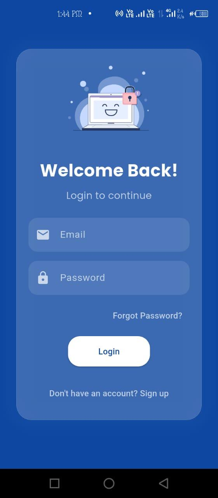
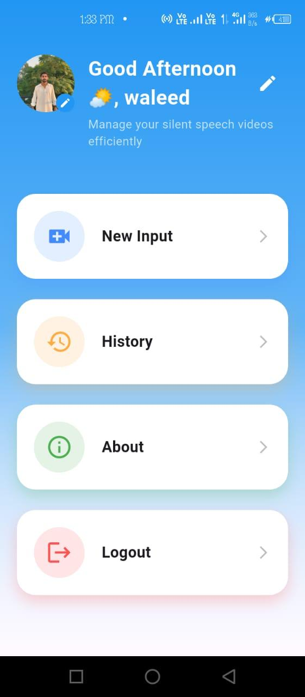
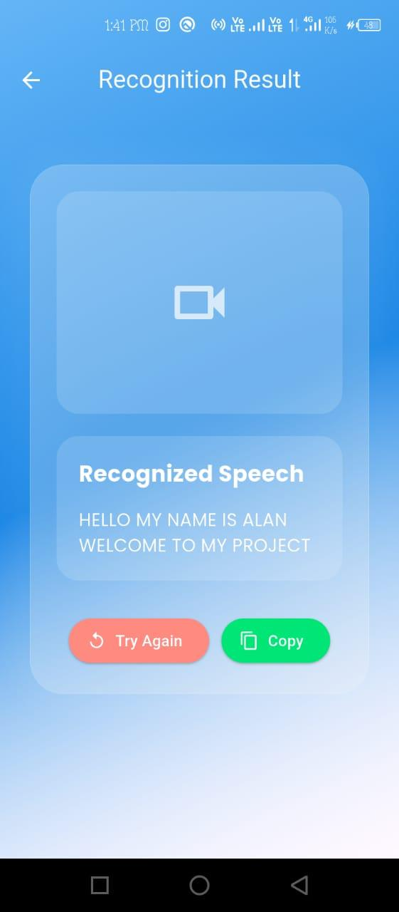

# AI-Powered Silent Speech Recognition System (AIPSRS)

An AI-powered mobile application that explores converting silent video recordings of lip movements into predicted text using a pretrained lip-reading model.

AIPSRS combines a Flutter mobile application, a Flask REST API, Supabase services, and a pretrained AI model integrated through Replicate.

## 📌 Project Overview

Communication can be challenging for people who have difficulty producing spoken speech. AIPSRS explores how artificial intelligence can help interpret lip movements from silent video recordings and convert them into text.

Users can upload a video through the mobile application, submit it for processing, and view the predicted text returned by the AI model.

The application also includes user authentication, prediction history, and text-to-speech functionality.

- **Project Type:** Final Year Project (FYP)
- **Platform:** Android
- **Focus Areas:** Artificial Intelligence, Mobile Application Development, Backend Integration

## ✨ Key Features

- **User Authentication:** Sign-up, login, and password recovery.
- **Silent Video Upload:** Select and submit a video for lip-reading inference.
- **AI-Powered Prediction:** Integrates a pretrained lip-reading model through Replicate.
- **Prediction Results:** Displays the text returned by the model.
- **Prediction History:** Provides access to previously saved predictions.
- **Text-to-Speech:** Allows predicted text to be spoken aloud.
- **REST API Integration:** Connects the Flutter application to a Flask backend.
- **Cloud Services:** Uses Supabase for authentication, database, and storage functionality.

## 🛠️ Technology Stack

| Component | Technology |
|---|---|
| Mobile Application | Flutter |
| Mobile Programming Language | Dart |
| Backend | Python, Flask |
| API Communication | REST API |
| AI Inference | Replicate |
| Lip-Reading Model | `basord/lip-reading-ai-vsr` |
| Authentication | Supabase Auth |
| Database | Supabase |
| Cloud Storage | Supabase Storage |
| Backend Deployment | Render |

**Model note:** This project integrates a pretrained lip-reading model. The model was not trained from scratch as part of this implementation.

## 📸 Application Preview

### Login Screen



### Home Screen



### Prediction Result



For more application screens, including sign-up, video input, prediction history, password recovery, and avatar options, visit the [Screenshots folder](docs/Screenshots/).

## 🎬 Project Demo

Watch the recorded demonstration of the AIPSRS mobile application.

**[▶️ Watch the Demo Video](docs/Demo_video.mp4)**

The video is available in the repository's `docs` directory.

## 📊 Project Presentation

The project presentation provides additional information about the objectives, design, and implementation.

**[📑 View the PowerPoint Presentation](docs/AI-Powered-Silent-Speech-Recognition-System.pptx)**

## 🏗️ System Architecture

AIPSRS follows a client-server architecture in which the Flutter mobile application communicates with a Flask backend. The backend integrates with Replicate for AI inference, while Supabase provides supporting cloud services.

```text
┌────────────────────────────────┐
│       Flutter Mobile App       │
│                                │
│  Authentication                │
│  Video Selection and Upload    │
│  Prediction Results            │
│  Prediction History            │
│  Text-to-Speech                │
└───────────────┬────────────────┘
                │
                │ REST API
                ▼
┌────────────────────────────────┐
│          Flask Backend         │
│                                │
│  Request Processing            │
│  AI Inference Integration      │
│  Prediction Handling           │
└───────────────┬────────────────┘
                │
                ▼
┌────────────────────────────────┐
│       Replicate Platform       │
│                                │
│  Pretrained Lip-Reading Model  │
│  Video Inference               │
│  Predicted Text                │
└────────────────────────────────┘

       Supporting Cloud Services
┌────────────────────────────────┐
│            Supabase            │
│  Authentication                │
│  Database                      │
│  Cloud Storage                 │
└────────────────────────────────┘
```

## 📂 Repository Structure

```text
AIPSRS/
├── README.md
├── .gitignore
├── app/
│   └── Flutter application source code
├── backend/
│   ├── app.py
│   ├── requirements.txt
│   ├── start.sh
│   └── ...
└── docs/
    ├── AI-Powered-Silent-Speech-Recognition-System.pptx
    ├── Demo_video.mp4
    └── Screenshots/
        ├── login.jpeg
        ├── signup.jpeg
        ├── home.jpeg
        ├── input.jpeg
        ├── result.jpeg
        ├── history.jpeg
        ├── forgot.jpeg
        └── avatar options.jpeg
```

## 🚀 Getting Started

### Prerequisites

- Flutter SDK and Dart
- Android Studio or another compatible Flutter development environment
- Python
- A configured Supabase project
- A Replicate account and API token for backend inference

### 1. Clone the Repository

```bash
git clone https://github.com/waleed239/AIPSRS.git
cd AIPSRS
```

If the project files are inside a subdirectory in your local clone, navigate to the directory containing `app`, `backend`, and `docs` before continuing.

### 2. Configure the Flutter Application

Navigate to the Flutter application directory:

```bash
cd app
flutter pub get
```

The application loads its environment configuration from:

`app/assets/.env`

Create this file locally with your own Supabase configuration:

```env
SUPABASE_URL=your_supabase_project_url
SUPABASE_ANON_KEY=your_supabase_anon_or_publishable_key
```

Use the variable names expected by the application. Never commit your actual `.env` file or private credentials to GitHub.

### 3. Configure the Flask Backend

Navigate to the backend directory:

```bash
cd ../backend
```

Create and activate a Python virtual environment.

**Windows:**

```bash
python -m venv venv
venv\Scripts\activate
```

Install the required dependencies:

```bash
pip install -r requirements.txt
```

Configure the environment variables required by the backend, including the Replicate API token and any necessary Supabase settings.

Keep private API tokens on the backend. Never embed a private Replicate API token in the Flutter application.

Refer to the backend configuration and startup instructions for the exact environment variable names and commands.

### 4. Run the Application

Start the Flask backend using the project's configured startup command.

Then navigate to the Flutter application directory and run:

```bash
flutter run
```

Make sure the Flutter application is configured to communicate with the correct backend URL.

> **Note:** These are general setup instructions. Additional configuration may be required depending on your environment and deployment settings.

## 👨‍💻 My Contribution

My work on this Final Year Project focused on mobile application development and integration with backend and AI services.

My contributions included:

- Developing the mobile application interface using Flutter and Dart.
- Implementing user-facing application screens and workflows.
- Integrating the Flutter application with a Flask REST API.
- Integrating a pretrained lip-reading model through Replicate.
- Integrating Supabase authentication, database, and storage functionality.
- Implementing video submission, prediction result display, and prediction history workflows.
- Working on the integration of text-to-speech functionality.

The lip-reading model was pretrained and accessed through Replicate; I did not train the model from scratch.

## ⚠️ Limitations

- The current implementation processes uploaded videos rather than providing live lip-reading.
- Prediction quality depends on the pretrained model and input video.
- Processing time may vary depending on video characteristics and the external inference service.
- Further evaluation is required to assess prediction accuracy and real-world usability.

## 🔮 Future Improvements

Potential future improvements include:

- Adding support for additional languages, including Urdu.
- Improving processing time and error handling.
- Enhancing accessibility and usability.
- Conducting structured usability testing.
- Evaluating prediction performance on an appropriate dataset.
- Exploring more efficient inference and deployment approaches.

These are proposed improvements rather than claims about existing functionality.

## 📚 Project Documentation

- [Project Presentation](docs/AI-Powered-Silent-Speech-Recognition-System.pptx)
- [Application Demo Video](docs/Demo_video.mp4)
- [Application Screenshots](docs/Screenshots/)
- [Flutter Application Source Code](app/)
- [Flask Backend Source Code](backend/)

## 🔐 Security

- Do not commit `.env` files or private API tokens.
- Keep private Replicate credentials on the backend.
- Configure appropriate Supabase Row Level Security (RLS) policies.
- Never expose Supabase service-role keys or database passwords in client-side code.
- Use environment variables to manage deployment secrets.

## 👤 Author

**Muhammad Waleed Wazir**

BS Computer Science Graduate | Software Development | AI/ML Integration | Flutter | Python

- **GitHub:** [@waleed239](https://github.com/waleed239)
- **Portfolio:** [Personal Portfolio Website](https://waleed239.github.io/portfolio-website/)

---

*Developed as a Final Year Project exploring AI-powered lip-reading through an accessible mobile application.*
